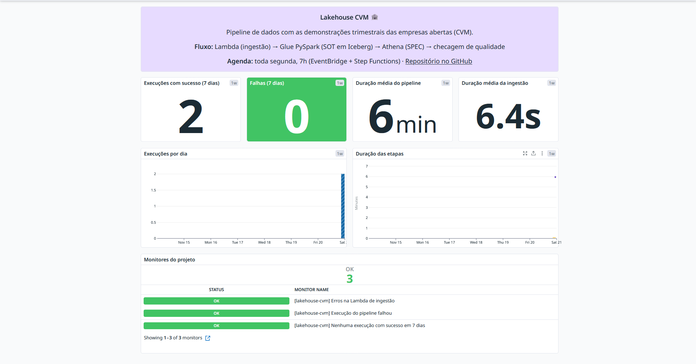
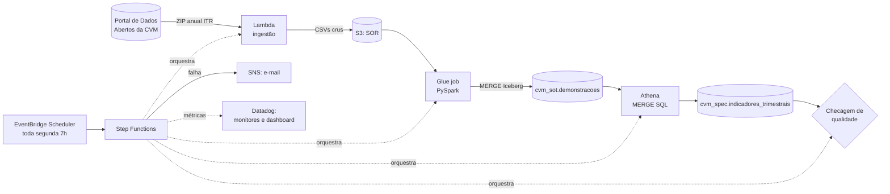
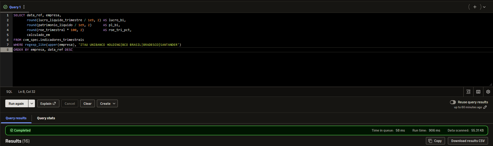
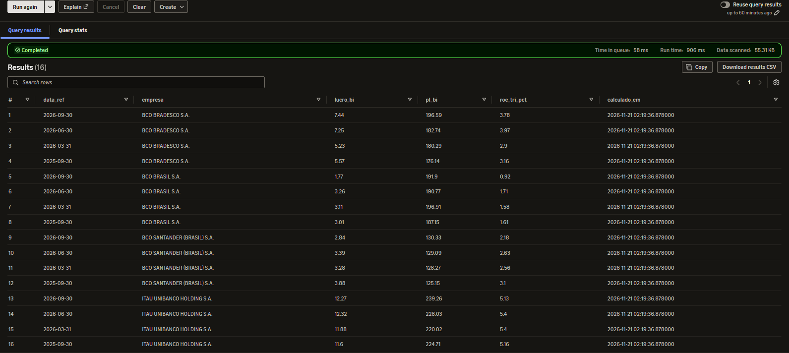
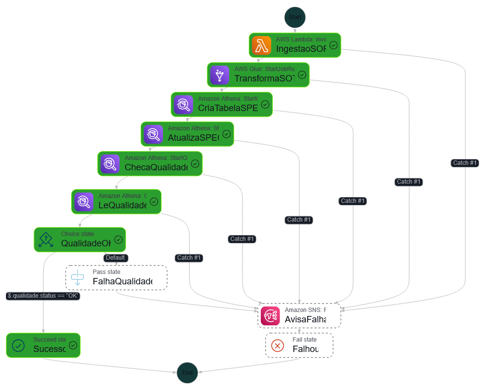
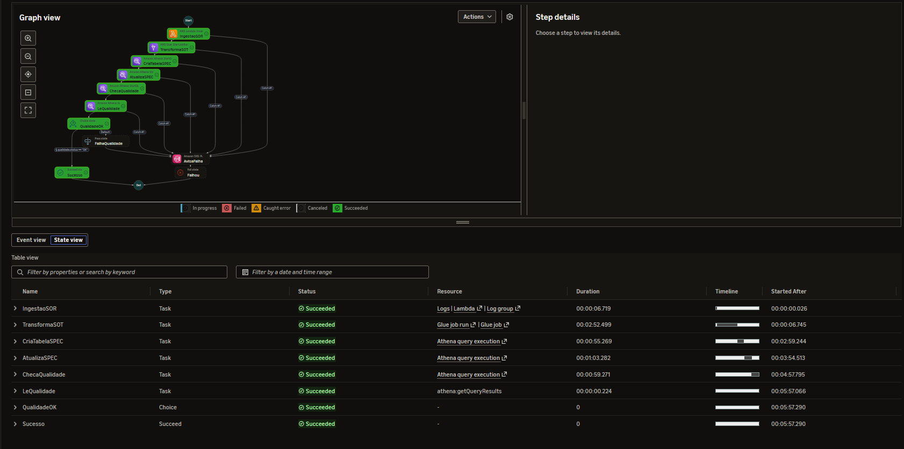
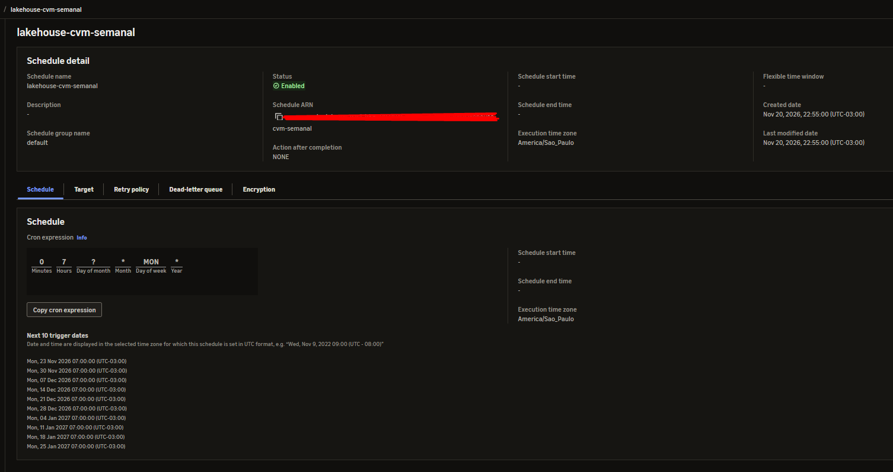
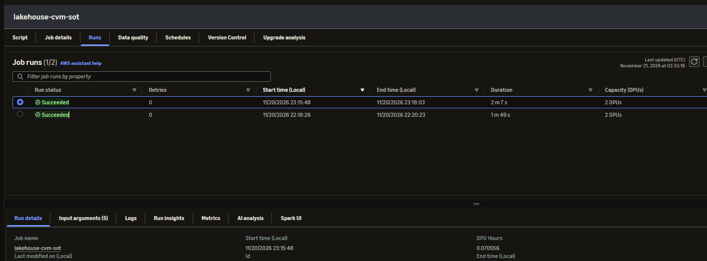

# Lakehouse CVM: indicadores trimestrais de empresas abertas na AWS

[](https://github.com/727wag/lakehouse-cvm/actions/workflows/ci.yml)


Pipeline de dados de ponta a ponta com **dados públicos da CVM**: baixa as Informações
Trimestrais (ITR) das companhias abertas, organiza em camadas **SOR → SOT → SPEC** sobre
**Apache Iceberg** e entrega indicadores prontos (ativo total, patrimônio líquido, lucro
do trimestre e ROE) para consulta no Athena.

Toda a infraestrutura é criada com **Terraform**, a orquestração roda sozinha toda semana
com **Step Functions + EventBridge Scheduler** e a saúde do pipeline é monitorada no
**Datadog**.



## Arquitetura



| Camada | Onde fica | O que tem |
|---|---|---|
| **SOR** | `s3://<bucket>/sor/cvm_itr/demonstrativo=*/ano=*/` | CSVs da CVM como vieram (BPA, BPP e DRE consolidados) |
| **SOT** | `cvm_sot.demonstracoes` (Iceberg) | Dados tipados, em reais, só a versão mais recente de cada linha |
| **SPEC** | `cvm_spec.indicadores_trimestrais` (Iceberg) | Uma linha por empresa e trimestre, com os indicadores calculados |

## Resultado

Indicadores do 3º trimestre de 2026 calculados pelo pipeline (valores em R$ bilhões):

| Empresa | Lucro do trimestre | Patrimônio líquido | ROE trimestral |
|---|---:|---:|---:|
| Itaú Unibanco Holding | 12,27 | 239,26 | 5,13% |
| Bradesco | 7,44 | 196,59 | 3,78% |
| Santander Brasil | 2,84 | 130,33 | 2,18% |
| Banco do Brasil | 1,77 | 191,90 | 0,92% |

<details>
<summary>Ver a query e o resultado no Athena</summary>




A consulta leu só 55 KB: a SPEC já guarda os indicadores prontos, em Parquet particionado por ano.

</details>

## O pipeline em funcionamento

**Orquestração.** A Step Function encadeia ingestão, transformação, SPEC e checagem de
qualidade. Qualquer erro cai no `AvisaFalha`, que manda e-mail pelo SNS.



Uma execução completa leva cerca de 6 minutos, e a maior parte é o job do Glue:



<details>
<summary>Agendamento e execuções do Glue</summary>

O EventBridge Scheduler dispara o pipeline toda segunda às 7h (horário de Brasília):



O job PySpark roda com 2 DPUs em cerca de 2 minutos:



</details>

## Decisões de engenharia

- **Idempotência em todas as etapas.** A ingestão sobrescreve os mesmos arquivos, a SOT e a
  SPEC usam `MERGE`. Rodar o pipeline duas vezes não duplica nada.
- **Reapresentações da CVM.** Empresas republicam demonstrativos. A SOT guarda só a maior
  `VERSAO` de cada linha (window function com `row_number()`), e a SPEC reprocessa os
  últimos 15 meses a cada execução.
- **MERGE null-safe.** Balanços não têm data de início de exercício. O `MERGE` da SOT compara
  a chave com `<=>`, porque `NULL = NULL` é falso e inseriria tudo de novo a cada execução.
- **Planos de contas diferentes.** Bancos e empresas comerciais descrevem o lucro de formas
  diferentes na DRE. Encontrei isso explorando os dados, e a SPEC aceita as duas descrições.
- **Falhar alto em vez de errar em silêncio.** Escala de moeda desconhecida, demonstrativo
  faltando no ZIP ou SPEC sem dados recentes interrompem o pipeline e disparam alerta.
- **Métricas em SQL, não em Python.** A regra de negócio fica na SPEC, consultável por
  qualquer pessoa no Athena.
- **Custo sob controle.** Glue com o mínimo de workers, workgroup do Athena com limite de bytes
  por query, resultados temporários apagados em 7 dias e alerta de orçamento mensal.
- **Permissões mínimas.** Cada serviço tem sua role: a Lambda só grava na SOR, o Glue só grava
  na SOT, o Scheduler só inicia a Step Function.
- **Observabilidade como código.** Monitores e dashboard do Datadog ficam no Terraform, junto
  com o resto da infraestrutura.

## Estrutura

```
infra/            Terraform (AWS + Datadog)
orquestracao/     definição da Step Function (template)
src/ingestao/     Lambda: CVM -> SOR
src/transformacao Glue job PySpark: SOR -> SOT
sql/spec/         DDL e MERGE da camada SPEC
sql/qualidade/    checagem lida pela Step Function
sql/analises/     queries de exploração e validação
tests/            pytest (funções de ingestão e transformação, SQL e Step Function)
docs/img/         prints usados neste README
```

## Como rodar

**Pré-requisitos:** conta AWS com o AWS CLI configurado, Terraform ≥ 1.6, Python ≥ 3.11 e,
para o Datadog, a integração AWS já ativa na conta.

```bash
# 1. Testes locais
python -m venv .venv && source .venv/bin/activate
pip install -r requirements-dev.txt
ruff check . && pytest

# 2. Infraestrutura
cd infra
cp terraform.tfvars.example terraform.tfvars   # ajuste o e-mail e o site do Datadog
source ~/.datadog-env                          # exporta DD_API_KEY e DD_APP_KEY (ou datadog_habilitado = false)
terraform init
terraform plan
terraform apply

# 3. Confirme a assinatura do SNS no e-mail e rode a primeira carga
aws stepfunctions start-execution --state-machine-arn "$(terraform output -raw state_machine_arn)"
```

Para carregar anos específicos, inicie a execução com `--input '{"anos": [2023, 2024, 2025]}'`.

## Custos

Uma execução custa por volta de **US$ 0,05**: o Glue usa cerca de 0,07 DPU-hora, o Athena lê
poucos MB e Lambda, Step Functions e Scheduler ficam dentro do nível gratuito. Rodando uma vez
por semana, fica abaixo de US$ 0,30 por mês. O orçamento configurado avisa por e-mail ao passar
de 80% do limite.

Para desligar tudo:

```bash
aws s3 rm s3://$(terraform output -raw bucket) --recursive   # o bucket precisa estar vazio
terraform destroy
```

## Limitações e próximos passos

- O 4º trimestre não está no ITR, só na DFP anual. Próximo passo: ingerir a DFP.
- Os indicadores dependem das descrições padronizadas de conta da CVM. Um plano de contas novo
  exige rodar `sql/analises/descobrir_contas.sql` e ajustar a SPEC.
- Métricas de negócio no Datadog (linhas ingeridas, empresas por trimestre) para detectar
  queda de volume, além de falhas técnicas.
- Deploy pelo GitHub Actions com OIDC, sem chaves de acesso guardadas.

## Fonte dos dados

[Portal de Dados Abertos da CVM: Formulário de Informações Trimestrais (ITR)](https://dados.cvm.gov.br/dataset/cia_aberta-doc-itr),
atualizado semanalmente.

---

Feito por [Wagner Bastos](https://www.linkedin.com/in/wabastos) · [GitHub](https://github.com/727wag)
