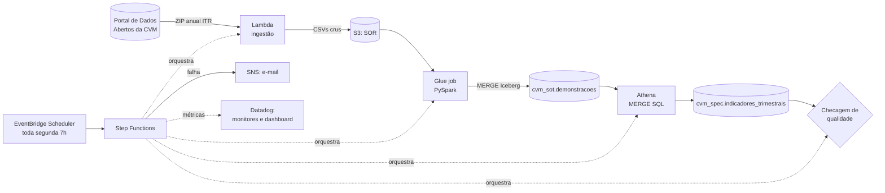

# Lakehouse CVM: indicadores trimestrais de empresas abertas na AWS

Pipeline de dados de ponta a ponta com **dados públicos da CVM**: baixa as Informações
Trimestrais (ITR) das companhias abertas, organiza em camadas **SOR → SOT → SPEC** sobre
**Apache Iceberg** e entrega indicadores prontos (ativo total, patrimônio líquido, lucro
do trimestre e ROE) para consulta no Athena.

Toda a infraestrutura é criada com **Terraform**, a orquestração roda sozinha toda semana
com **Step Functions + EventBridge Scheduler** e a saúde do pipeline é monitorada no
**Datadog**.

## Arquitetura



| Camada | Onde fica | O que tem |
|---|---|---|
| **SOR** | `s3://<bucket>/sor/cvm_itr/demonstrativo=*/ano=*/` | CSVs da CVM como vieram (BPA, BPP e DRE consolidados) |
| **SOT** | `cvm_sot.demonstracoes` (Iceberg) | Dados tipados, em reais, só a versão mais recente de cada linha |
| **SPEC** | `cvm_spec.indicadores_trimestrais` (Iceberg) | Uma linha por empresa e trimestre, com os indicadores calculados |

## Decisões de engenharia

- **Idempotência em todas as etapas.** A ingestão sobrescreve os mesmos arquivos, a SOT e a
  SPEC usam `MERGE`. Rodar o pipeline duas vezes não duplica nada.
- **Reapresentações da CVM.** Empresas republicam demonstrativos. A SOT guarda só a maior
  `VERSAO` de cada linha, e a SPEC reprocessa os últimos 15 meses a cada execução.
- **MERGE null-safe.** Balanços não têm data de início de exercício. O `MERGE` da SOT compara
  a chave com `<=>`, porque `NULL = NULL` é falso e inseriria tudo de novo a cada execução.
- **Falhar alto em vez de errar em silêncio.** Escala de moeda desconhecida, demonstrativo
  faltando no ZIP ou SPEC sem dados recentes interrompem o pipeline e disparam alerta.
- **Métricas em SQL, não em Python.** A regra de negócio fica na SPEC, consultável por
  qualquer pessoa no Athena.
- **Custo sob controle.** Glue com o mínimo de workers, workgroup do Athena com limite de bytes
  por query, resultados temporários apagados em 7 dias e alerta de orçamento mensal.
- **Permissões mínimas.** Cada serviço tem sua role: a Lambda só grava na SOR, o Glue só grava
  na SOT, o Scheduler só inicia a Step Function.

## Estrutura

```
infra/            Terraform (AWS + Datadog)
orquestracao/     definição da Step Function (template)
src/ingestao/     Lambda: CVM -> SOR
src/transformacao Glue job PySpark: SOR -> SOT
sql/spec/         DDL e MERGE da camada SPEC
sql/qualidade/    checagem lida pela Step Function
sql/analises/     queries de exploração e validação
tests/            pytest (funções de ingestão e transformação, SQL e Step Function)
```

## Como rodar

**Pré-requisitos:** conta AWS com o AWS CLI configurado, Terraform ≥ 1.6, Python ≥ 3.11 e,
para o Datadog, a integração AWS já ativa na conta.

```bash
# 1. Testes locais
pip install -r requirements-dev.txt
ruff check . && pytest

# 2. Infraestrutura
cd infra
cp terraform.tfvars.example terraform.tfvars   # ajuste o e-mail e o site do Datadog
export DD_API_KEY=...  DD_APP_KEY=...          # ou datadog_habilitado = false
terraform init
terraform fmt -recursive
terraform plan
terraform apply

# 3. Confirme a assinatura do SNS no e-mail e rode a primeira carga
$(terraform output -raw comando_executar_agora)
```

Para carregar anos específicos, inicie a execução com `{"anos": [2023, 2024, 2025]}`.

Depois da primeira carga, rode `sql/analises/descobrir_contas.sql` no Athena para conferir
as descrições de conta usadas no cálculo da SPEC.

## Custos

Com uma execução por semana, o custo fica em centavos por mês: o Glue cobra por minuto de
execução, o Athena pelos poucos MB lidos, e Lambda, Step Functions e Scheduler ficam dentro
do nível gratuito. O orçamento configurado avisa por e-mail ao passar de 80% do limite.

Para desligar tudo: `terraform destroy` (o bucket precisa estar vazio).

## Limitações e próximos passos

- O 4º trimestre não está no ITR, só na DFP anual. Próximo passo: ingerir a DFP.
- Os indicadores dependem das descrições padronizadas de conta da CVM. Bancos usam um plano de
  contas diferente, então vale validar com a query de descoberta.
- Dashboard em HTML lendo um JSON gerado a partir da SPEC.
- Métricas de negócio no Datadog (linhas ingeridas, empresas por trimestre) para detectar
  queda de volume, além de falhas técnicas.

## Fonte dos dados

[Portal de Dados Abertos da CVM: Formulário de Informações Trimestrais (ITR)](https://dados.cvm.gov.br/dataset/cia_aberta-doc-itr),
atualizado semanalmente.
